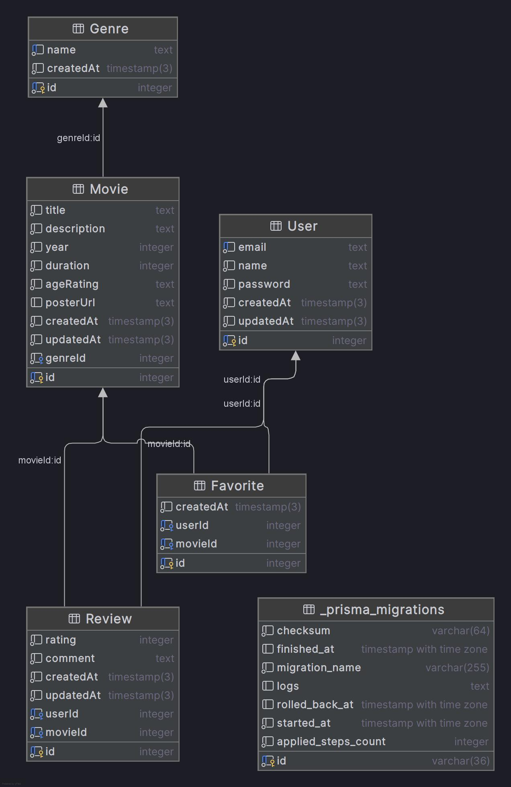

## Алексеева Виктория Дмитриевна, М3312
### Тема: онлайн-кинотеатр «KINO»

Онлайн-кинотеатр с подборкой фильмов и сериалов.  
На главной странице доступны рекомендуемые фильмы и новости. На странице профиля отображаются аватар, ФИО, email и информация о действующей подписке. Также есть избранное, выбор подписки и блок с рецензиями.

**Функциональность:**
- Список фильмов и сериалов: поиск и сортировка по названию.
- Рецензии: пользователи могут добавлять и редактировать рецензии.
- Обработка ошибок: при ошибках валидации email и сетевых ошибках показываются всплывающие уведомления.
- Подтверждение действий: после успешного добавления/сохранения рецензии показывается сообщение об успехе.

**Deploy (Render):** https://vikaleks.onrender.com/

### База данных (2 лабораторная)
Я использовала Prisma ORM для работы с PostgreSQL, развернутой на Aiven.
Схема БД описана в schema.prisma, после чего через Prisma Migrate были созданы таблицы.
Модель включает 5 сущностей и отражает предметную область онлайн-кинотеатра

**БД** 
* User - пользователь системы
* Movie - фильм
* Genre - жанр фильма
* Review - отзыв юзера
* Favorite - избранные фильмы юзера

**Связи**
* Один жанр содержит несколько фильмов
* Один пользователь может оставить несколько отзывов
* Один фильм может иметь несколько отзывов
* Пользователи и фильмы связаны через избранное
